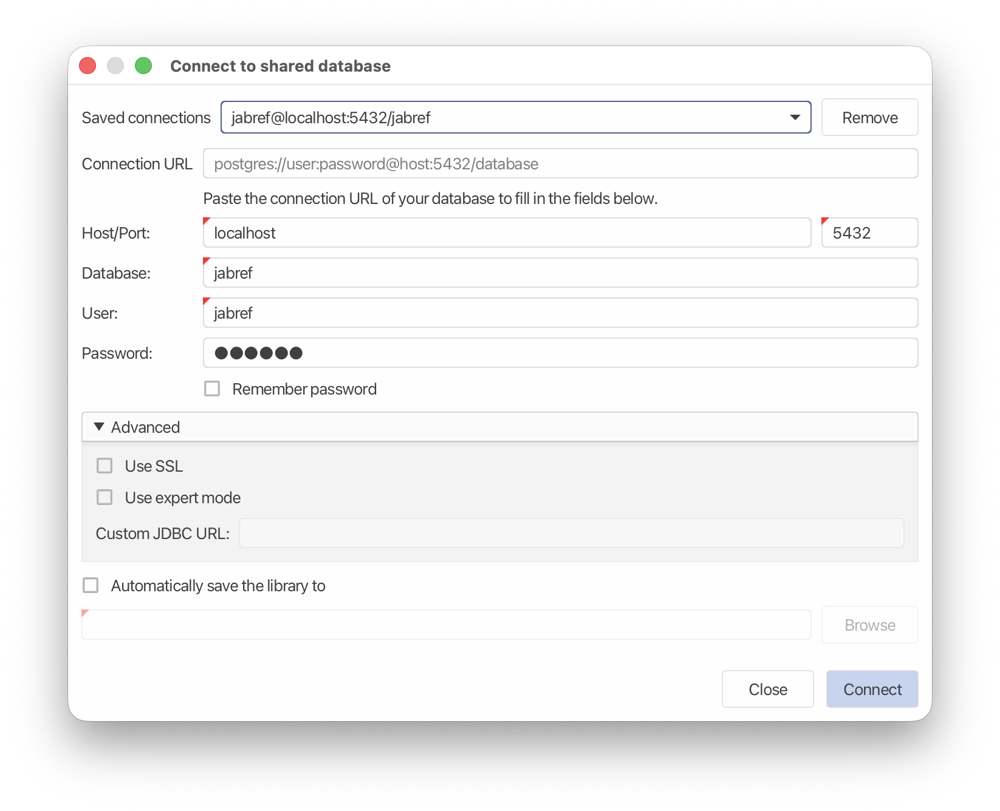
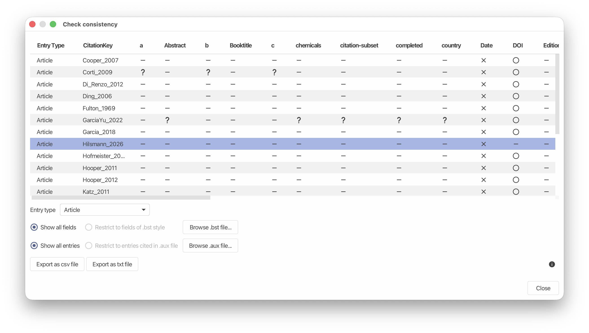
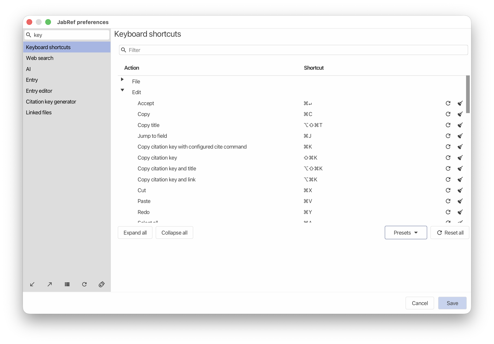
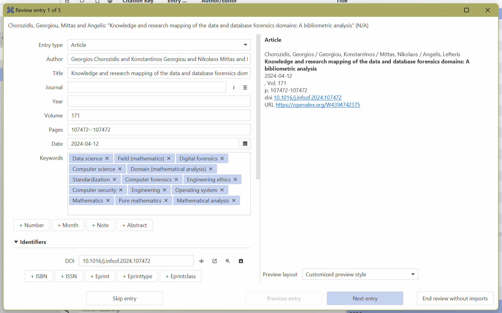
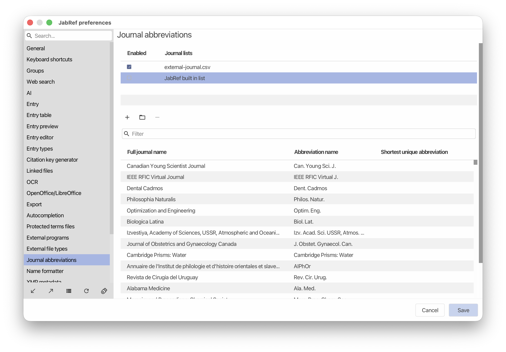

We got GTA VI before JabRef 6.0 Release, but rest assured not all our developers are spending time in Vice City. They are instead working on finishing the release of JabRef 6.0. 
This beta release already addresses the most issues of the 6.0 milestone, only a few are left.
Do yourself and us a favour and please test this beta release a final time so that the JabRef 6.0 release can be finished soon.

## Release Highlights

The changelog lists a wide range of bug fixes outnumbering the new features and enhancements by a large margin. Some of the changes stand out notably.
For instance, we improved the groups and search performance in large libraries and compared to 6.0-beta.1, the full-text search is fully functional again.

### Theming and Styling

In the preferences you can now switch between a more compact maintainable style or a wrapping text style and choosing a larger font size should now be way less painful, although some slight tweaks here and there might be necessary. We also improved a couple of visibility issues in the [dark and light themes](https://themes.jabref.org/), including the search related buttons, which priorly confronted users with the impossible task of having to distinguish between two similar colours for enabled and disabled.

### Shared databases

The [PostgreSQL shared database integration](https://docs.jabref.org/collaborative-work/sqldatabase) has been improved, and you can now see the latest stored database connections.

### LibreOffice integration

In Zotero Compatibility Mode, you can now import cited entries from a LibreOffice document into your library.
You can also now seamlessly switch within and across all supported citation style families (CSL, BST & [JStyles](https://docs.jabref.org/cite/openofficeintegration#the-style-file)) without having to delete and re-insert any existing citations.
A lot of other quality-of-life improvements are in place - for more details, read the changelog!

### Import and Export

JabRef now integrates with [CiteDrive](https://www.citedrive.com/) and supports both importing from and exporting to CiteDrive.
In addition, we also added [BibSonomy](https://bibsonomy.org/) as new fetcher. You need to configure a free API key in order to use this feature.

Extracting and recognizing identifiers like ISBN from PDFs with or without OCR has been massively improved.
For those who share their BibTeX library via git, libraries can now be merged with the new JabKit Git merge driver and you can now use automatically generated Git commit messages.

We now also support exporting publications list in Markdown format and fixed a few bugs in the exporting routine.

## Consistency check

The [consistency check](https://docs.jabref.org/finding-sorting-and-cleaning-entries/checkconsistency) now supports LaTeX's `.aux` files and BibTeX's `.bst` styles.

## macOS usage

For macOS users, there is now a Mac-specific keybinding preset which allows you to use native macOS text-editing shortcuts in JabRef.

## Citation Relations

It is now possible to review and edit entries before importing them in the "Citations" tab of the entry editor. Especially convenient for those folks that want a distraction free experience or look out for data quality and take the opportunity there to control for integrity and completeness by fetching bibliographic data from DOI.

## Citation annotations

The formerly read-only displayed annotations now are linked to the location in the PDF. Double-clicking the annotation opens the users PDF-reader and jumps to said location, which makes this feature a lot more user-friendly.

## Journal abbreviations

A long wished feature was to enable/disable the internal journal abbreviations and just use a custom list of abbreviations. This is now possible by using the redesigned Journal Abbreviations tab in the preferences.

## Known Issues

- Centering the caret line inside the BibTeX source code editor via keyboard shortcut on macOS is currently not supported due to a limitation in the JavaFX library [JDK-8380073](https://bugs.openjdk.org/browse/JDK-8380073).
- AI chat/AI summarization: The chunked algorithm might require further work. It is advised to experiment a little with the context length setting, preferably with a tiny local model, before querying an expensive API [Forum issue 9149](https://discourse.jabref.org/t/tried-mistral-ai-it-did-not-work-but-now-i-cant-run-jabref-it-at-all/9149/3)

<!-- List known issues, if any. -->

## Special Thanks

We want to thank all the users who are constantly testing the latest snapshots and providing feedback!
Furthermore, we would like to thank our [donators](https://donations.jabref.org) and JabRef e.V. members who made it possible for many JabRef developers to attend the conference and to support our work.
In case you like to donate money regularly, we would prefer via our bank account (tax-deductible and no fees) or via GitHub Sponsors as the fees are lower than PayPal.

We thank all the external contributors who contributed code and reviewed Pull Requests and helped to make JabRef a better tool.

|                                                                                                                                                       |                                                                                                                                                                 |                                                                                                                                                       |                                                                                                                                                       |
|-------------------------------------------------------------------------------------------------------------------------------------------------------|-----------------------------------------------------------------------------------------------------------------------------------------------------------------|-------------------------------------------------------------------------------------------------------------------------------------------------------|-------------------------------------------------------------------------------------------------------------------------------------------------------|
|              |                       | Ahmed Ragab                                                                                                                                           |           |
| [AbdoSoliman1](https://github.com/AbdoSol1iman)                                                                                                       | [Aditya Mukesh](https://github.com/adityamukesh)                                                                                                                |                                                                                                                                                       | [Ahmed Ragab Ali](https://github.com/A7MEDRAGAB82)                                                                                                    |
|                |                          |         |                |
| [Alex Maksimov](https://github.com/maleksware)                                                                                                        | [Aman Gautam](https://github.com/Gautam-aman)                                                                                                                   | [Ana Tereza R. S. Pereira](https://github.com/atrsp)                                                                                                  | [Andre Paa](https://github.com/Andre-Paa-ANU)                                                                                                         |
|         |                                          |                      |       |
| [Anish Kumar Singh](https://github.com/AnishKmSingh)                                                                                                  | [anson](https://github.com/anson)                                                                                                                               | [ansonpoh](https://github.com/ansonpoh)                                                                                                               | [Anuruddha](https://github.com/anuruddha-pratap-singh)                                                                                                |
|                   |                                    |                   |                          |
| [Ayush Jha](https://github.com/aj-codespy)                                                                                                            | [benbbj](https://github.com/benbbj)                                                                                                                             | [Bertie Hunt](https://github.com/u8216739)                                                                                                            | [bljr07](https://github.com/bljr07)                                                                                                                   |
|      |                 |                |                 |
| [Carlos Alberto](https://github.com/albCarlosRodrigues)                                                                                               | [Caroline Marques Lau](https://github.com/cmarqueslau)                                                                                                          | [codex-local](https://github.com/codex-local)                                                                                                         | [Congyu Liu](https://github.com/CongyuLiu09)                                                                                                          |
|            |                              |                  |                        |
| [Constant-Sudo](https://github.com/Constant-Sudo)                                                                                                     | [Dark Blue](https://github.com/pluto-han)                                                                                                                       | [Darren Peck](https://github.com/peckyboi2)                                                                                                           | [David Mo](https://github.com/unknown)                                                                                                                |
|             |                          |                             |             |
| [Tan Yen Chong](https://github.com/Eternal-Wynn)                                                                                                      | [Faneesh Juneja](https://github.com/faneeshh)                                                                                                                   | [FIRST](https://github.com/FIRST)                                                                                                                     | [garethbilaney](https://github.com/garethbilaney)                                                                                                     |
|  |                                     |                           |          |
| [Ha Minh Dung Nguyen](https://github.com/HaMinhDung-Nguyen)                                                                                           | [Hancong](https://github.com/Hancong)                                                                                                                           | [HARSHIT](https://github.com/HARSHIT)                                                                                                                 | [JabRef Machine](https://github.com/jabref-machine)                                                                                                   |
|    |                                      |              |                         |
| [JaidevKaleeswaran](https://github.com/JaidevKaleeswaran)                                                                                             | [jaslyn](https://github.com/jaslyn)                                                                                                                             | [JenniferLu03](https://github.com/JenniferLu03)                                                                                                       | [Jonas](https://github.com/jonas-ee)                                                                                                                  |
|                         |                                 |              |              |
| [Justus](https://github.com/zjjchan)                                                                                                                  | [Kenneth](https://github.com/Kineth-t)                                                                                                                          | [kenneth21tay](https://github.com/kenneth21tay)                                                                                                       | [kierenswag59](https://github.com/kierenswag59)                                                                                                       |
|                |                                  |                    |                              |
| [Kirill Porokh](https://github.com/1mbanamid)                                                                                                         | [kjshoom](https://github.com/kjshoom)                                                                                                                           | [kpunia306](https://github.com/kpunia306)                                                                                                             | [Krish](https://github.com/krish)                                                                                                                     |
|              |                            |                     |                         |
| [Lalit Kishore R](https://github.com/doraem-on)                                                                                                       | [linamedani](https://github.com/linamedani)                                                                                                                     | [Linnea Grambo](https://github.com/linnea)                                                                                                            | [Linuger](https://github.com/Linuger)                                                                                                                 |
|          |                      |          |                           |
| [Loay Tarek Mostafa](https://github.com/LoayTarek5)                                                                                                   | [lolo-2016-dev](https://github.com/lolo-2016-dev)                                                                                                               | [Mahesh Bhosale](https://github.com/bhosale-mahesh)                                                                                                   | [Marcus](https://github.com/ppv-1)                                                                                                                    |
|                     |  |                  |           |
| [Marius Hanl](https://github.com/Maran23)                                                                                                             | [medavarapu saathvik](https://github.com/saathvikmedavarapu2111-a11y)                                                                                           | [MelinaBelh](https://github.com/MelinaBelh)                                                                                                           | [Mohamed Ashraf](https://github.com/abousalama-dev)                                                                                                   |
|          |                              |                     |                 |
| [Nayan Pokhriyal](https://github.com/nayanhasnolyf)                                                                                                   | [nericensy](https://github.com/nericensy)                                                                                                                       | [Ng Jackin](https://github.com/NgJackin)                                                                                                              | [Nisanth S](https://github.com/Nisanth-2025)                                                                                                          |
|                          |                                    |            |                        |
| [nnylac](https://github.com/nnylac)                                                                                                                   | [noreply](https://github.com/noreply)                                                                                                                           | [NoureddineCH1](https://github.com/NoureddineCH1)                                                                                                     | [nysta12](https://github.com/nysta12)                                                                                                                 |
|          |                                  |                        |                         |
| [Olle Håkansson](https://github.com/ollehaakansson)                                                                                                   | [Olle Törnström](https://github.com/olle)                                                                                                                       | [Pole959](https://github.com/Pole959)                                                                                                                 | [Ramisha](https://github.com/Ramisha)                                                                                                                 |
|                              |                       |  |            |
| [ruslan](https://github.com/Ruslan)                                                                                                                   | [Ryan George](https://github.com/ryangeorge-dev)                                                                                                                | [Sachin Chandra Yadav](https://github.com/SachinyadavAug20)                                                                                           | [Sandeep332005](https://github.com/Sandeep332005)                                                                                                     |
|                    |                                |          |  |
| [SaraAnn Stanway](https://github.com/sara)                                                                                                            | [saral693](https://github.com/saral693)                                                                                                                         | [saurav poddar](https://github.com/thesauravpoddar)                                                                                                   | [Senthil Kumar Rajendran](https://github.com/senthilkumar-r)                                                                                          |
|                   |                          |               |                              |
| [Shiva Patel](https://github.com/shispate)                                                                                                            | [Shu-lin-Liu](https://github.com/Shu-lin-Liu)                                                                                                                   | [Siva Sankar](https://github.com/sivasankar-4)                                                                                                        | [skull](https://github.com/ddd)                                                                                                                       |
|          |                            |                         |                   |
| [Skyhawkcoder30](https://github.com/Skyhawkcoder30)                                                                                                   | [srv19!!](https://github.com/shubh19062003)                                                                                                                     | [tasmin](https://github.com/txsminn)                                                                                                                  | [theo canuto](https://github.com/canutoth)                                                                                                            |
|                    |                                |               |               |
| [Trevorwrz](https://github.com/Trevorwrz)                                                                                                             | [u7455900](https://github.com/u7455900)                                                                                                                         | [Ujjwal Surabhi](https://github.com/Ujjwals17)                                                                                                        | [Victória Mottin](https://github.com/vsmottin)                                                                                                        |
|                      |                              |                           |             |
| [Víctor Jalencas](https://github.com/victor)                                                                                                          | [Wanling](https://github.com/wanling0000)                                                                                                                       | [Yash](https://github.com/yashh7p)                                                                                                                    | [Yasmin Kotb](https://github.com/Eng-YasminKotb)                                                                                                      |
|                  |                                |                                |              |
| [YasmineBML](https://github.com/YasmineBML)                                                                                                           | [ychavezr](https://github.com/ychavezr)                                                                                                                         | [yosr](https://github.com/yosr)                                                                                                                       | [Yosr Bejaoui](https://github.com/Yosr-Bejaoui)                                                                                                       |
|                       |                 |              |                                                                                                                                                       |
| [yquanjun](https://github.com/yquanjun)                                                                                                               | [Zeyad Abdelfattah](https://github.com/ZiadAbdElFatah)                                                                                                          | [Zongjing-Han](https://github.com/Zongjing-Han)                                                                                                       |                                                                                                                                                       |

## Download

Download [6.0-beta2 from GitHub](https://github.com/JabRef/jabref/releases/tag/v6.0-beta.2). 
